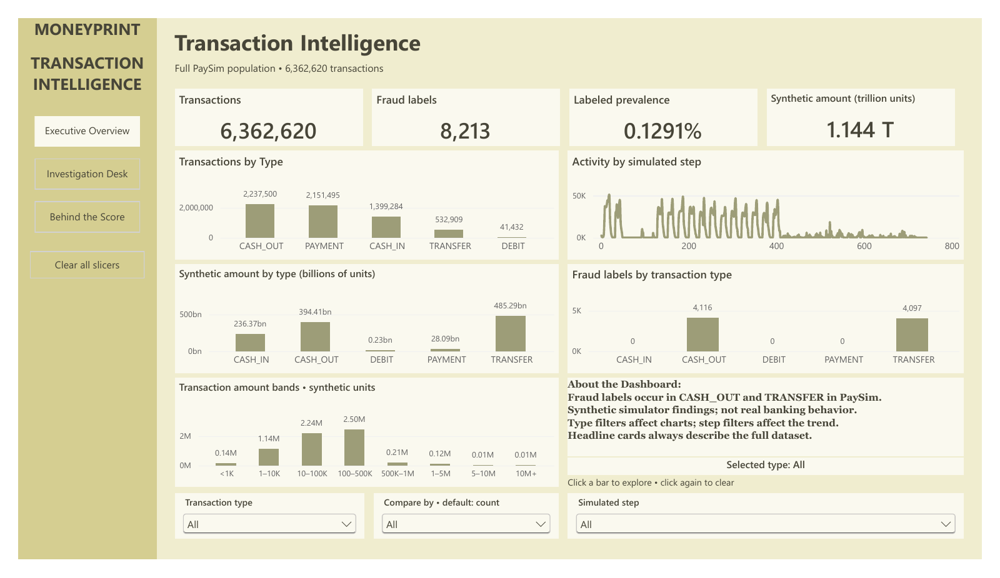
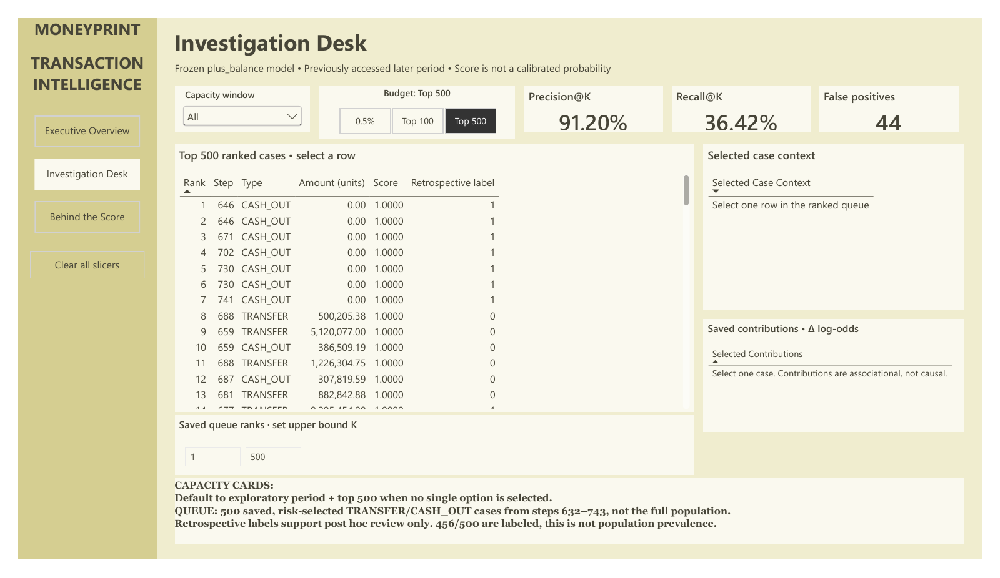
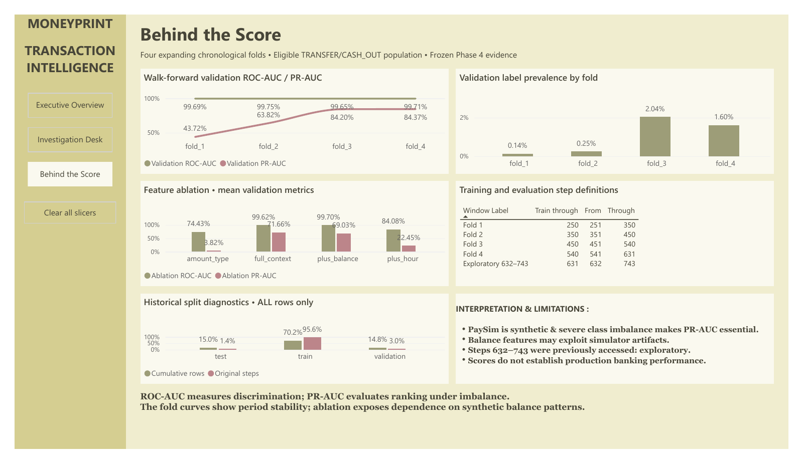

# MONEYPRINT

Transaction intelligence, investigation prioritization, and responsible model evaluation on **6,362,620 synthetic PaySim transactions**.

MONEYPRINT connects Python, DuckDB, SQL, and a frozen scikit-learn model with a three-page Power BI Desktop report. It emphasizes reconciled data, chronological evaluation, and transparent limitations.

## Dashboard

Open `powerbi/MONEYPRINT.pbix` for the packaged report or `powerbi/MONEYPRINT.pbip` for the editable project. See `powerbi/FINAL_HANDOVER.md` for the actual save/reopen verification status.

| Page | Analytical story |
| --- | --- |
| Transaction Intelligence | Full-population KPIs, volume and synthetic value by type, amount distribution, simulated-step activity |
| Investigation Desk | Frozen top-500 ranking, budget comparisons, selected-case context, retrospective review |
| Behind the Score | Four expanding validation folds, feature ablations, prevalence shift, evaluation windows, limitations |

The report uses the approved muted palette and 1280 × 720 canvas. In Desktop authoring mode, use **Ctrl+click** for native page navigation and clear-slicers buttons. Select a queue row to inspect its saved context. Executive cards remain dataset-wide when descriptive charts are filtered.

Hover over a transaction-type bar to see exact counts, population share, synthetic amount, fraud labels, and fraud-label rate. The **Compare by** dropdown switches between transaction count, synthetic amount in billions, and fraud count. The selected-type indicator tracks All, one type, or multiple types. Investigation budget tiles switch between Top 100, Top 500, and the 0.5% alert-rate budget; the selected window and budget do not change the saved exploratory case queue. Navigation and reset buttons have hover feedback.

The PBIX contains imported data and can be opened without the raw dataset. To refresh the report or use the editable PBIP on another computer, update the local CSV paths in the semantic model's Power Query sources to your checkout's `powerbi/exports/` directory. The published project excludes machine-specific Power BI caches. See `powerbi/VISUAL_QA_REPORT.md` for verified interactions and the remaining manual check of held mouse-down button appearance.

The 8,213 synthetic fraud labels represent 0.1291% of the full population. The later-period top-500 list contains 456 retrospective labels: 91.2% precision and 36.42% recall within its saved eligible population. This selected subset does not estimate population prevalence.

## Project structure

- `data/raw/`: source dataset copies; excluded from version control.
- `data/processed/`: reserved for derived data; excluded from version control.
- `notebooks/`: exploratory analysis.
- `src/`: reusable Python analysis code.
- `sql/`: investigation queries.
- `powerbi/`: final PBIX/PBIP report, PBIR/TMDL definitions, fixed exports, QA evidence, and screenshots. Local backups and duplicate development projects are excluded from Git.
- `reports/`: generated audit outputs.

## Setup

Python 3.12 is used for the current environment. Activate the virtual environment and install dependencies with:

```powershell
python -m venv .venv
.\.venv\Scripts\Activate.ps1
python -m pip install -r requirements.txt
```

Place the PaySim CSV at `data/raw/PS_20174392719_1491204439457_log.csv`. Run the full-file audit with:

```powershell
python src/audit.py
```

The audit writes `reports/paysim_audit.json` and `reports/paysim_audit.md`. It uses DuckDB to scan the CSV and aggregate results without loading the complete dataset into a pandas DataFrame. Its balance checks are simplified diagnostics, not validated accounting rules; Phase 2 decomposes observed balance changes by transaction type and account-ID prefix.

## Phase 2

Run exploratory summaries, balance diagnostics, the chronological feature build, and its tests with:

```powershell
python -m src.phase2_eda
python -m unittest discover -s tests -v
```

The pipeline writes compact EDA results to `reports/phase2_eda.json` and `reports/phase2_eda.md`, and a compressed feature dataset to `data/processed/transaction_features.parquet`. The feature table keeps the fraud label as a target separate from its predictor columns. It uses chronological step ranges and strictly earlier-step receiver history; it does not train a model or export a Power BI CSV.

The PaySim data is synthetic and should not be interpreted as real customer or financial activity.

## Training Runtime

`src/runtime_config.py` detects logical/physical CPU counts and available RAM before NumPy/scikit-learn are imported by the training modules. It caps BLAS at up to 16 threads (reserving at least 20% of physical cores), sets OpenMP to one thread to avoid nested oversubscription, and keeps model-level parallel fit jobs at one for reproducibility. The current machine reports 20 physical cores, 28 logical CPUs, and about 28.8 GiB available RAM; its planned budget is 16 BLAS threads plus one OpenMP thread.

Training entry points record elapsed fit time, process and host CPU utilization, peak process RSS, minimum available system memory, and effective thread pools in their reports. Inspect the saved Phase 4 model without fitting with:

```powershell
python -m src.runtime_config
```

That command prints hardware, configured thread limits, and active numerical thread pools. It does not train or benchmark a model. The existing Phase 4 model/protocol remain frozen unless a separate experiment is explicitly requested.

## Portfolio Model and Power BI Package

The authoritative portfolio model is the frozen `phase4_walkforward_v1` balanced Logistic Regression using the `plus_balance` feature configuration. It is trained on simulated steps 1–631, with four expanding chronological validation folds; steps 632–743 are a previously accessed exploratory later period, not a pristine holdout. The mean validation ROC-AUC is 0.996989 and mean validation PR-AUC is 0.690274 for selected-population metrics. The saved Phase 4 report is authoritative; do not combine these with Phase 3 model scores.

The selected model is available at `models/phase4_walkforward_v1_final_model.joblib`. Frozen protocol and evaluation details are in `models/phase4_walkforward_v1_protocol.json` and `reports/phase4_walkforward_v1.md` / `.json`. The dashboard exporter reads these artifacts and the existing Parquet, scores only the capped later-period investigation list with `predict_proba`, and never calls model fitting:

```powershell
python -m src.powerbi_exports
python -m unittest tests.test_powerbi_exports -v
```

CSV outputs are written to `powerbi/exports/`; `export_manifest.json` records model/report provenance and integrity-check totals. The final report is already assembled. `powerbi/MONEYPRINT_THEME.json`, `POWER_BI_BUILD_GUIDE.md`, `DASHBOARD_WIREFRAME.md`, and `POWER_BI_BUILD_CHECKLIST.md` document its design and development. Original backups are retained locally under `powerbi/backups/` and excluded from the repository. See the final handover for packaged PBIX verification and screenshots.

Portfolio highlights: DuckDB-based 6.36M-row analysis, memory-conscious Parquet features, strictly prior-step recipient history, chronology-safe walk-forward evaluation, model-attribution-based selected cases, reconciliation checks, and explicit synthetic-data / simulation-artifact caveats. Sender balance features are decision-time inputs but may exploit PaySim balance-generation shortcuts; performance is not validated real-world fraud detection and is not a bKash system.
## Methodology and portfolio evidence

PaySim is synthetic. Step represents simulated time, and amounts have no documented currency. Sender balance features may exploit simulator artifacts. Scores are ranking signals, not calibrated probabilities; model contributions are associational, not causal. The previously accessed steps 632–743 are exploratory, not a pristine holdout. Results do not establish production banking performance.

The report keeps population aggregates, evaluation metrics, and case-level records at their proper grains. Relationships flow from dimensions to facts. Historical split diagnostics remain disconnected. Retrospective labels support post hoc review and are not decision-time inputs.

`powerbi/QA_EXPORT_RECONCILIATION.json` records focused reconciliation and per-export hashes. `powerbi/UX_VERIFICATION.json` and `powerbi/PBIX_VERIFICATION.json` record the final enhanced delivery. `powerbi/REPORT_LAYOUT.json` records the earlier layout baseline. The report build did not retrain, regenerate exports, or alter frozen artifacts. Build and repair scripts are historical development records; do not run them over the final report as a rebuild command.

## Dashboard captures






